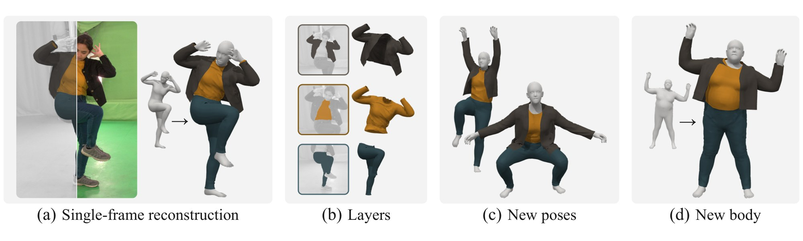

# TERZI: Three-dimensional Garment Generation and Retargeting via Optimization-free Inference

**Emirhan Bilgiç, Rıza Alp Güler** · Department of Computing, Imperial College London

[Project page](https://emirhanbilgic.github.io/TERZI/) · [Model weights](https://huggingface.co/emirhanbilgic/TERZI)



TERZI generates separate, image-aligned 3D garment meshes from a single image of a clothed person and an estimate of their
SMPL-X body. Two body-conditioned flow-matching transformers, in the sparse structured latent space of
[TRELLIS.2](https://github.com/microsoft/TRELLIS.2), first predict the cells the garment occupies and then the surface inside
them. The garment is generated around the given body, so it is a separate mesh by construction. With the body estimated from
the image the model reconstructs the garment; with a different body it generates the same garment directly in the new pose
or body shape, without skinning or simulation.

## Installation

Tested with Python 3.12, PyTorch 2.9 (CUDA 13.0) on NVIDIA H200 GPUs; any recent CUDA GPU with about 24 GB of memory runs
inference.

```bash
git clone --recursive https://github.com/emirhanbilgic/TERZI.git
cd TERZI
# TRELLIS.2 and its CUDA extensions (flash-attn, nvdiffrast, cumesh, o-voxel, flex_gemm), see TRELLIS.2/README.md
cd TRELLIS.2 && . ./setup.sh --basic --flash-attn --nvdiffrast --cumesh --o-voxel --flexgemm && cd ..
pip install -r requirements.txt
```

The models use [DINOv3](https://huggingface.co/facebook/dinov3-vitl16-pretrain-lvd1689m), which is gated on Hugging Face:
accept its license and log in (`hf auth login`). The weights of TERZI and the frozen TRELLIS / TRELLIS.2 decoders are
downloaded automatically on first use.

The body is an SMPL-X mesh. To use SMPL-X vertices without faces (as in the example) or SMPL-X parameters, download the
SMPL-X model from [smpl-x.is.tue.mpg.de](https://smpl-x.is.tue.mpg.de) and put `SMPLX_NEUTRAL.npz` in `data/`.

## Inference

```bash
# the whole outfit
python infer.py --image examples/pexels_8052611/image.jpg --person-mask examples/pexels_8052611/person_mask.png \
    --body examples/pexels_8052611/body.npz --K examples/pexels_8052611/K.json --smplx-model data/SMPLX_NEUTRAL.npz \
    --out output/

# the garment(s) selected by a mask, with the masked model; --fast uses its one-step student
python infer.py --image examples/pexels_8052611/image.jpg --person-mask examples/pexels_8052611/person_mask.png \
    --body examples/pexels_8052611/body.npz --K examples/pexels_8052611/K.json --smplx-model data/SMPLX_NEUTRAL.npz \
    --garment-mask examples/pexels_8052611/garment_mask.png --out output_masked/ [--fast]
```

Writes `garment.glb` / `garment.obj` (camera frame, metres), the conditioning `body.glb`, the 512 x 512 input crop
`cond.png` and the four body renders `body_views.png`.

**Hole filling** (`--holes`, `terzi/postprocess.py`). The TRELLIS.2 shape decoder can leave holes in the garment surface.

- `patch` (default): fills every hole with a perimeter below 10 cm, then closes larger holes with body-guided patches. Rays
  cast from the body along its normals find body regions the garment neither covers nor is pierced by; the enclosed ones
  (not touching the head, neck, hands or feet) smaller than 2% of the body surface get a patch, the body surface pushed out
  to the surrounding cloth. Needs an SMPL-X body and `--smplx-model`.
- `fast`: only the holes below 10 cm. This is the post-processing of every number in the paper and of `evaluation/`.
- `none`: the raw decoder output.

**Inputs.**

- **Image** and **person mask** (white = the person). `--auto-mask` computes the mask with BiRefNet
  ([briaai/RMBG-2.0](https://huggingface.co/briaai/RMBG-2.0), gated).
- **Body**: an SMPL-X mesh in the camera frame of the image (metres; x right, y down, z forward), e.g. from
  [GVHMR](https://github.com/zju3dv/GVHMR), [PromptHMR](https://github.com/yufu-wang/PromptHMR) or
  [SAM 3D Body](https://github.com/facebookresearch/sam-3d-body) (converted to SMPL-X). Give an `.npz` with `vertices`
  (and optionally `faces`, `pelvis` or `joints`), a mesh file, or SMPL-X parameters with `--smplx-params`.
- **Intrinsics** `--K` (a json / npy 3 x 3 matrix) or `--focal` in pixels: the camera your body estimator assumed.
- **Garment mask** (masked models only): white = the garment(s) to generate. The full-outfit mask generates the whole outfit;
  a mask of one garment (e.g. from [SAM](https://github.com/facebookresearch/segment-anything)) generates that garment.

**Retargeting.** Keep the image and the garment mask and give another body (a new pose, a new shape, or both): the masked
model generates the same garment on it.

**Python.**

```python
import numpy as np
from PIL import Image
from terzi import TerziPipeline, load_body

pipe = TerziPipeline.from_pretrained("terzi_masked")      # terzi | terzi_masked | terzi_student | terzi_masked_student
body = load_body("examples/pexels_8052611/body.npz", smplx_model="data/SMPLX_NEUTRAL.npz")
image = np.asarray(Image.open("examples/pexels_8052611/image.jpg").convert("RGB"))
person = np.asarray(Image.open("examples/pexels_8052611/person_mask.png").convert("L"))
mask = np.asarray(Image.open("examples/pexels_8052611/garment_mask.png").convert("L"))
K = np.array([[2202.9, 0, 960], [0, 2202.9, 540], [0, 0, 1]])
out = pipe(image, person, K, body, garment_mask=mask, seed=0, holes="patch")   # or "fast", "none"
out.garment.export("garment.glb")
```

## Models

| Name | Input | Sampling | 4D-DRESS CD (cm) | Penetration (%) |
|---|---|---|---|---|
| `terzi` | image + body | 12 + 12 steps, CFG 7.5 | 1.484 | 1.65 |
| `terzi_masked` | image + body + garment mask | 12 + 12 steps, CFG 7.5 | 1.528 | 0.58 |
| `terzi_student` | image + body | 1 + 1 step | 1.475 | 1.42 |
| `terzi_masked_student` | image + body + garment mask | 1 + 1 step | 1.529 | 0.46 |

Segmentation protocol, 64 frames, GVHMR bodies (paper Tab. 2 and supplementary Tab. 16). The weights are on
[Hugging Face](https://huggingface.co/emirhanbilgic/TERZI).

## Evaluation

`evaluation/` reproduces the 4D-DRESS and CloSe numbers of the paper (Tab. 2, supplementary Tabs. 10 and 13-17).

```bash
# CloSe: render the 146 frontal test images and their ground truth from the CloSe-Di scans
python evaluation/prep_close.py --close <CloSe-D root> --out data/close_bench
# generate (raw garments) with a body estimate per frame: <bodies>/<id>.npz in the camera frame of the benchmark image
python evaluation/generate.py --bench 4ddress --dataset <4D-DRESS root> --bodies <bodies> --model terzi --out runs/4dd_terzi
python evaluation/generate.py --bench close --dataset data/close_bench --bodies <bodies> --model terzi --out runs/close_terzi
# score: post-processing, alignment, both protocols, penetration, holes
python evaluation/score.py --bench 4ddress --dataset <4D-DRESS root> --run runs/4dd_terzi
python evaluation/score.py --bench close --dataset data/close_bench --run runs/close_terzi
```

The frames are listed in `evaluation/benchmarks/`. The paper conditions on GVHMR bodies on 4D-DRESS and on PromptHMR
bodies on CloSe; no ground-truth pose or shape is used. `metrics.py` documents the protocol (supplementary Sec. 9).

| | Segmentation CD / NC / F@1 | GT label transfer CD / NC / F@1 |
|---|---|---|
| 4D-DRESS, `terzi` | 1.484 / .813 / .481 | 1.477 / .816 / .485 |
| 4D-DRESS, `terzi_masked` | 1.528 / .811 / .465 | 1.503 / .815 / .476 |
| CloSe, `terzi` | 1.202 / .837 / .534 | 1.148 / .843 / .553 |
| CloSe, `terzi_masked` | 1.228 / .834 / .523 | 1.167 / .840 / .544 |

## Training

All models are trained on [BEDLAM2.0](https://bedlam2.is.tue.mpg.de) only. `training/README.md` describes the full
pipeline: data preparation, the main model, the masked model, the collision-aware fine-tuning and the distillation.

## Repository

```
terzi/          inference package (crop and cube mapping, body renders, the two-stage sampler, hole filling)
infer.py        command-line inference
examples/       a demo input (a frame of a Pexels video, its masks, intrinsics and GVHMR body vertices)
configs/        model and trainer configurations of the two DiTs
training/       data preparation, training, fine-tuning and distillation
evaluation/     benchmark generation, metrics and scoring
TRELLIS.2/      submodule: microsoft/TRELLIS.2
```

## License

The code and the weights are released for non-commercial research use under
[CC BY-NC 4.0](https://creativecommons.org/licenses/by-nc/4.0/). The models were trained on BEDLAM2.0 and are conditioned on
SMPL-X bodies; use them in accordance with the licenses of BEDLAM2.0, SMPL-X, TRELLIS.2 and DINOv3. The example frame is
from a [Pexels](https://www.pexels.com/video/8052611/) video.

## Citation

```bibtex
@article{bilgic2026terzi,
  title   = {{TERZI}: Three-dimensional Garment Generation and Retargeting via Optimization-free Inference},
  author  = {Bilgi{\c{c}}, Emirhan and G{\"u}ler, R{\i}za Alp},
  journal = {arXiv preprint},
  year    = {2026}
}
```

## Acknowledgements

TERZI builds on [TRELLIS.2](https://github.com/microsoft/TRELLIS.2) and [DINOv3](https://github.com/facebookresearch/dinov3),
and is trained on [BEDLAM2.0](https://bedlam2.is.tue.mpg.de).
